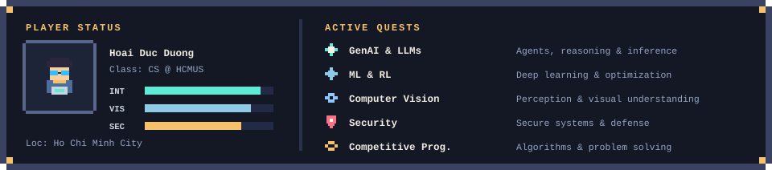
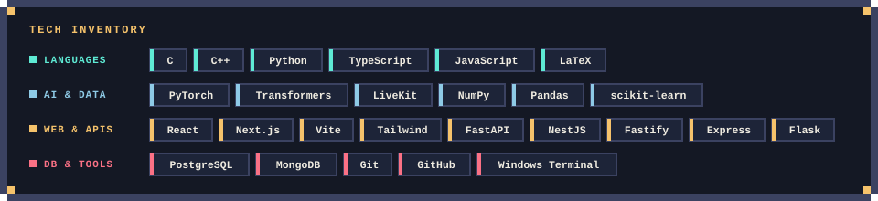

  <picture>
    <source media="(prefers-color-scheme: dark)" srcset="./assets/hero-dark.svg" />
    <source media="(prefers-color-scheme: light)" srcset="./assets/hero-light.svg" />
    
  </picture>

 

  
  
  
  
  

 

  <picture>
    <source media="(prefers-color-scheme: dark)" srcset="./assets/quest-dark.svg" />
    <source media="(prefers-color-scheme: light)" srcset="./assets/quest-light.svg" />
    
  </picture>

 

  <picture>
    <source media="(prefers-color-scheme: dark)" srcset="./assets/inventory-dark.svg" />
    <source media="(prefers-color-scheme: light)" srcset="./assets/inventory-light.svg" />
    
  </picture>

 

### Stats

  <picture>
    <source media="(prefers-color-scheme: dark)" srcset="https://github-readme-stats.vercel.app/api?username=Hoaiduc195&show_icons=true&hide_border=false&border_radius=4&bg_color=141824&border_color=3b4261&title_color=f5c26b&icon_color=8ecae6&text_color=e6e1d6&ring_color=f5c26b&rank_icon=github" />
    <source media="(prefers-color-scheme: light)" srcset="https://github-readme-stats.vercel.app/api?username=Hoaiduc195&show_icons=true&hide_border=false&border_radius=4&bg_color=fbf8f1&border_color=3a3d4e&title_color=b5651d&icon_color=3b82a6&text_color=232635&ring_color=c97b36&rank_icon=github" />
    
  </picture>
  <picture>
    <source media="(prefers-color-scheme: dark)" srcset="https://github-readme-stats.vercel.app/api/top-langs/?username=Hoaiduc195&layout=compact&hide_border=false&border_radius=4&bg_color=141824&border_color=3b4261&title_color=f5c26b&text_color=e6e1d6" />
    <source media="(prefers-color-scheme: light)" srcset="https://github-readme-stats.vercel.app/api/top-langs/?username=Hoaiduc195&layout=compact&hide_border=false&border_radius=4&bg_color=fbf8f1&border_color=3a3d4e&title_color=b5651d&text_color=232635" />
    
  </picture>

 

  <picture>
    <source media="(prefers-color-scheme: dark)" srcset="https://streak-stats.demolab.com/?user=Hoaiduc195&background=141824&border=3b4261&border_radius=4&stroke=3b4261&ring=f5c26b&fire=f5c26b&currStreakNum=f5f1e6&sideNums=f5f1e6&currStreakLabel=8ecae6&sideLabels=94a3c4&dates=7d8bb0" />
    <source media="(prefers-color-scheme: light)" srcset="https://streak-stats.demolab.com/?user=Hoaiduc195&background=fbf8f1&border=3a3d4e&border_radius=4&stroke=e2d9c8&ring=c97b36&fire=c97b36&currStreakNum=232635&sideNums=232635&currStreakLabel=3b82a6&sideLabels=5a6275&dates=6b7280" />
    
  </picture>

 

  <code>★ Thanks for visiting — feel free to connect ★</code>

