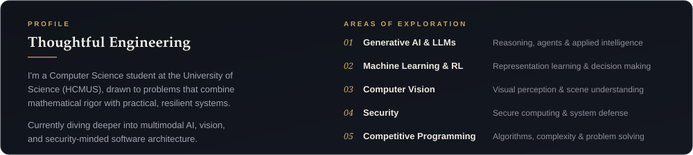

  

 

  
  
  
  
  

 

  

 

### Technical Stack

  
    
  
    
  Also working with: <code>Transformers</code> · <code>LiveKit</code> · <code>Fastify</code> · <code>NumPy</code> · <code>Pandas</code> · <code>scikit-learn</code> · <code>Windows Terminal</code>

 

### GitHub Overview

  
  

 

  

 

  <em>Thanks for stopping by — always happy to connect and exchange ideas.</em>

